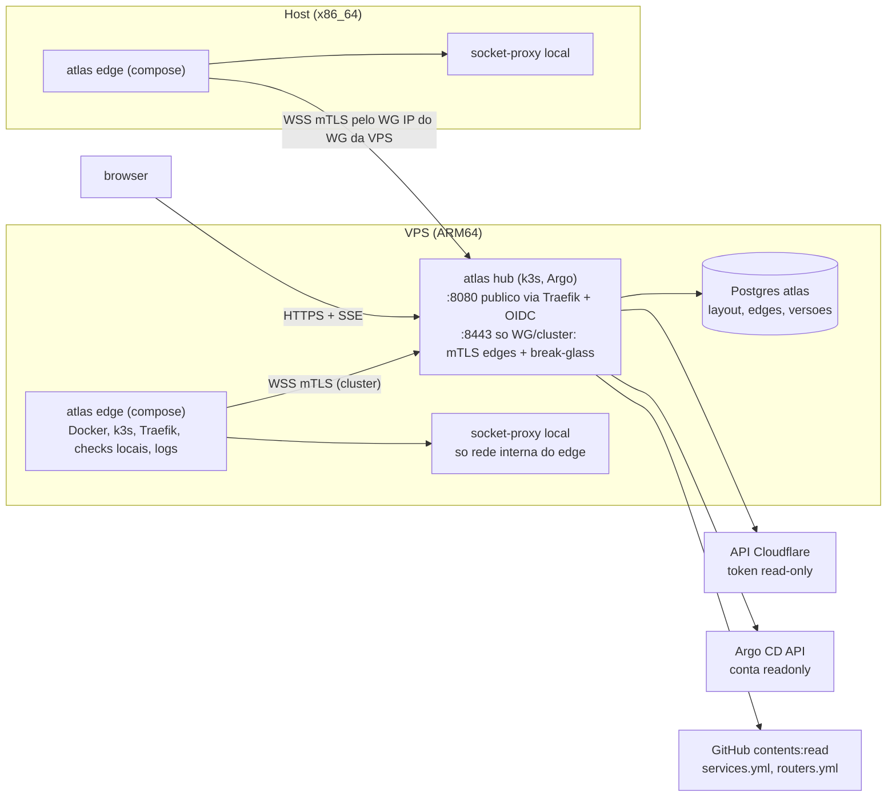

# Cyber Atlas: design

O Cyber Atlas é o mapa vivo do homelab: um `atlas hub` central e um `atlas edge` por máquina, só leitura.

**Decisões:** Java 21+ / Quarkus com virtual threads e native image multi-arch (amd64 + arm64); edge desde o MVP; Cloudflare pela API desde o MVP.

**Referências de padrão:**
- [HiveKeeper](https://github.com/ggfto/HiveKeeper): o mapa em React Flow (`topology.js` puro e testado) e o protocolo agente → gateway (WebSocket de saída, enrollment com CSR, mTLS).
- [Homelable](https://github.com/Pouzor/homelable), MIT: ideias de separar fato e apresentação, chave sintética por fonte, `parentId` com topo-sort, dagre. Créditos em [`NOTICE`](../NOTICE).

## 1. Arquitetura hub + edge

### 1.1 Protocolo edge → hub
**Transporte: WebSocket sobre TLS com mTLS, aberto pelo edge**, no padrão do `hive-agent`: uma conexão persistente que sai do edge, multiplexada, sem porta de entrada na máquina do edge.

**Por que não gRPC nem SSE:**
- **SSE** é unidirecional, e o hub precisa mandar comandos (abrir/fechar log, pedir snapshot).
- **gRPC bidi** funcionaria, mas exige HTTP/2 ponta a ponta, acrescenta protobuf/codegen ao native image e foge do molde já provado no HiveKeeper.
- O WebSocket do Quarkus (`quarkus-websockets-next`) serve servidor no hub e cliente no edge.

**Caminho de rede:**
- O edge do **host** disca para o hub **pelo WG** (`wss://IP do WG da VPS:<nodeport-8443>`).
- O da **VPS** disca pelo Service do cluster.
- **Nunca pela Cloudflare:** o túnel termina o TLS e o certificado de cliente não chega ao hub.
- Consequência: WG fora deixa o edge do host desconectado, e o mapa mostra isso como "host: edge sem conexão" (estado `unknown` com motivo, §3.3), o que já é informação útil.

**Frames** (JSON, um por mensagem de texto; o `protocolVersion` vai no `Hello`):

| frame | direção | uso |
|---|---|---|
| `Hello(edgeId, protocolVersion, machine, capabilities[], adapterVersions{})` | edge → hub | identificação. **A identidade vem do CN do certificado**, não do `Hello`; o hub rejeita se divergirem |
| `Welcome(sessionId, acceptedVersion, config{intervals, allowlists})` | hub → edge | aceita a versão (o hub suporta N e N-1) e manda a config de coleta. Versão fora da janela leva `Reject(reason)` e o edge **não** fica em loop de reconexão rápida |
| `Snapshot(source, seq, observedAt, ttlMs, nodes[], edges[])` | edge → hub | estado completo de uma fonte, na conexão e periodicamente |
| `Patch(source, seq, baseSeq, ops[])` | edge → hub | **planejado, não implementado**: hoje o edge manda só `Snapshot` periódico. Mudança incremental (eventos Docker, informers do k8s); `baseSeq` errado faria o hub pedir `Resync(source)` |
| `Resync(source)` | hub → edge | pede um snapshot novo |
| `LogOpen(streamId, target, container?, tail, since?, follow)` | hub → edge | abre um follow local |
| `LogLines(streamId, seq, lines[], dropped)` | edge → hub | linhas já redigidas no edge (§4), em lotes de até 64 KB |
| `Credit(streamId, n)` | hub → edge | **controle de fluxo**: o edge só manda até `n` lotes; sem crédito, descarta as mais antigas e soma em `dropped` |
| `LogClose(streamId, reason)` | os dois sentidos | fim |
| `Heartbeat(epochMs)` | os dois sentidos | a cada 20 s; 3 perdidos levam a reconectar |

**Reconexão:**
- Backoff exponencial com jitter de 20%, como no `WebSocketFrameChannel.java:123-135`.
- Ao reconectar, o edge manda **snapshots completos** de todas as fontes. Não há fila de jobs nem `Resume`: o estado é derivável. Isso é mais simples que o HiveKeeper, porque o atlas não executa comandos.
- **Corrida da conexão meio-aberta** (lição documentada no `agent-protocol.md`, "A reconnect outruns the old socket's close"): o registro de edges no hub guarda o `sessionId` dono da entrada e **só remove quando o close vem dessa sessão**. Um close atrasado da sessão antiga é ignorado.
- Os streams de log abertos caem na desconexão. O hub manda `event: end {reason:"edge-reconnect"}` ao browser, que reabre com `since` = último timestamp recebido.

**Enrollment e identidade** (molde do HiveKeeper, simplificado para uma pessoa só):
1. O admin cria o edge no hub (`POST /api/edges {machine}`) e recebe um **token de uso único**, válido 1 h.
2. Na primeira subida, o edge gera o par de chaves **localmente** e manda um CSR para `POST /api/enrollments/{token}/certificate` (porta 8443, só WG/cluster). O hub assina com a **CA própria do atlas**, com **CN = edgeId atribuído pelo servidor** (o subject do CSR é ignorado), EKU `clientAuth` e validade de 90 dias. O token é consumido atomicamente.
3. **Renovação** aos 30 dias do fim, autenticada pelo próprio certificado atual, sem trocar o par de chaves (molde `EnrollmentRenewal.java` do HiveKeeper). **Planejado, não implementado:** hoje um certificado perto do fim exige `POST /api/edges/{id}/re-enroll` + `enroll.sh`.
4. **Revogação:** `POST /api/edges/{id}/revoke` faz o hub recusar o handshake e a renovação. Não precisa de CRL, porque o hub é o único verificador.
5. A chave da CA do atlas fica em Secret do k8s e tem **cópia no cofre**, fora da infra .

### 1.2 O que roda no edge (um por máquina)
Fontes **locais**, que precisam de acesso de dentro da máquina:

| adapter | lê | permissão |
|---|---|---|
| `docker` (TopologySource + LogSource) | `GET /containers/json`, `GET /events`, `GET /containers/{id}/logs` | via **socket-proxy local**, que **não sai da máquina**: rede Docker interna só com o edge (no k3s, sidecar no mesmo pod, ouvindo só no loopback), `wollomatic/socket-proxy` com allowlist só-GET por regex (`containers/json`, `events`, `containers/<id>/logs`). Além disso, o cliente do edge tem **allowlist de endpoints no código**: `/containers/{id}/json` (inspect, que traz `Config.Env`) **nunca** é chamado, e há teste disso |
| `kubernetes` (TopologySource + LogSource) | informers de nodes, pods, deploy/sts/ds, services, ingress, IngressRoute; `pods/log` | ServiceAccount `atlas-edge` com ClusterRole **mínima** (molde `k8s/host/dozzle/rbac.yaml`): `get/list/watch` nesses recursos + `pods/log`; **sem** `secrets`, `configmaps`, `exec`, `portforward` nem escrita (§4) |
| `traefik` | `/api/http/routers`, `/services` (com `serverStatus` UP/DOWN), `/middlewares` | API do Traefik **da própria máquina** pela rede Docker interna. **Dispensa a rota `api@internal` pelo WG**  |
| `checks` locais | backend interno de cada serviço do `services.yml` (ex.: `http://fx-panel:8080/health`) e a rota `*.local.gf2.in` | rede do edge; o status do **upstream** vem daqui (§1.4) |
| `wireguard` (**planejado, não implementado**; sem issue aberta) | sonda TCP no IP do WG do outro lado | sem `NET_ADMIN` |

### 1.3 O que roda no hub
Fontes **globais**:

| adapter | lê | credencial |
|---|---|---|
| `servicesyml` | `host/services.yml`, `vps/services.yml`, `*/traefik/dynamic/routers.yml` (ramo `stable`) | token GitHub fine-grained, **contents:read só em `ggfto/infra`**. Nunca montar um checkout do repo de infra (pode conter credenciais locais) |
| `cloudflare` | DNS de `gf2.in` (nome, tipo, proxied), túneis (status, conexões) e ingress dos túneis (hostname → serviço) | token **read-only**: `Zone:Read`, `DNS:Read`, `Cloudflare Tunnel:Read` |
| `argocd` | `/api/v1/applications` (sync, health, recursos) | conta local `atlas`, `apiKey`, papel `applications, get` + `clusters, get` |
| `checks` públicos | as rotas `*.gf2.in` pela internet (o mesmo caminho do usuário) | nenhuma |

### 1.4 Status real (armadilha do Homelable provada no lab: "<500 = online" atrás do Authentik)
Cada serviço tem **expectativas explícitas**, derivadas do `services.yml` e sobrescrevíveis por serviço:

- **Rota pública com `auth: true`:** esperar **302/303 com `Location` em `auth.gf2.in`**. Isso prova Cloudflare + Traefik + forwardAuth, e **não** prova que o app está de pé. Qualquer outra coisa (200 sem auth, 5xx, timeout) é falha. **Um 200 numa rota que deveria estar protegida é alerta de segurança**, e aparece como `degraded` com motivo "rota protegida respondeu sem login".
- **Status do upstream:** vem de duas fontes independentes do Authentik: o check **do edge direto no backend interno** (`healthPath`, default `/`, esperando 2xx/3xx configurável) e o **`serverStatus` do Traefik** para aquele service.
- **Rota sem auth** (ex.: HA, 9router com SSO próprio): status esperado configurável, default 2xx/3xx sem seguir redirect para fora do domínio.
- O **TLS** de cada rota também é medido: dias até o vencimento do cert, que fica `degraded` abaixo de 14.

## 2. Stack
**Backend:** Java 21 LTS (ou 25 quando o Quarkus LTS da época suportar), Quarkus 3.x LTS.

| necessidade | extensão Quarkus |
|---|---|
| REST + SSE para o browser | `quarkus-rest-jackson` (`Multi<…>` com `@RestStreamElementType`, `SseEventSink`) |
| WebSocket servidor (hub) e cliente (edge) | `quarkus-websockets-next` |
| agendamento dos polls | `quarkus-scheduler` |
| virtual threads nos adapters bloqueantes (HTTP de APIs, Docker, logs) | `Thread.ofVirtual()` / `Executors.newVirtualThreadPerTaskExecutor()` direto nos adapters |
| k8s | `quarkus-kubernetes-client` (fabric8, suportado em native) |
| Docker | **cliente próprio** sobre `UnixDomainSocketAddress` + `SocketChannel` do JDK, compatível com native. Implementa só os 3 GETs permitidos, com allowlist no código. Isso evita o docker-java (problemático em native) e é a própria garantia "nunca inspect" |
| OIDC | `quarkus-oidc` (web-app com Authentik; `roles.role-claim-path=groups`) |
| banco | `quarkus-jdbc-postgresql` + `quarkus-flyway`, com JDBC direto nos stores (sem Hibernate/Panache) |
| front servido pelo hub | `quarkus-quinoa`, que builda o Vite e serve o estático |
| métricas/saúde | `quarkus-smallrye-health` (`/q/health`) e `quarkus-micrometer` (opcional) |

**Módulos Maven:**

| módulo | conteúdo | depende de |
|---|---|---|
| `atlas-core` | records `Node`, `Edge`, `NodeStatus`/`State`, `Fragment`, `LogRequest`, `LogLine`; SPI `TopologySource`/`Watcher`/`LogSource`; **merge e correlação puros** (regras de estado, frescor, chaves); `Sanitizer` (allowlist por tipo) e `Redactor` (RE2J, ver abaixo) | só JDK + `com.google.re2j` |
| `atlas-protocol` | frames do §1.1 + codec JSON (Jackson) | `atlas-core` |
| `atlas-adapters-edge` | docker, kubernetes, traefik, checks locais (`wireguard` planejado, não implementado: `EdgeKind.WIREGUARD` existe, mas nenhuma fonte o produz) | `atlas-core` |
| `atlas-adapters-hub` | servicesyml, cloudflare, argocd, checks públicos | `atlas-core` |
| `atlas-edge` | app Quarkus: cliente WS, enrollment, controle de fluxo de log (renovação planejada, §1.1) | os 3 acima |
| `atlas-hub` | app Quarkus: API, SSE, WS server, CA, registro de edges, OIDC, persistência | todos |
| `atlas-web` | Vite + React 18 + `@xyflow/react` + `@mriqbox/ui-kit` + Vitest; `buildInfraTopology()` pura (molde do `topology.js` do HiveKeeper e das colunas do §4.2) | — |

**Regex de usuário no filtro de log:** `java.util.regex` faz backtracking (ReDoS). Use **RE2J** (`com.google.re2j`, tempo linear) no filtro e na redação. Foi o argumento que me fazia preferir Go no v1, e assim ele deixa de pesar.

**Native image multi-arch:**
- GraalVM não faz cross-compile. A CI precisa de **dois builds nativos**, um por arquitetura: `ubuntu-24.04` (amd64) e `ubuntu-24.04-arm` (arm64), com `quarkus.native.container-build=true`. Depois um `docker manifest` junta `ghcr.io/ggfto/cyberatlas-hub` e `ghcr.io/ggfto/cyberatlas-edge` (tags `sha-*`, `main`, `stable`), no fluxo do 9router (`docker-publish` + `promote-stable`).
- O repo `ggfto/cyberatlas` é **público**, então o runner arm64 hospedado pelo GitHub (`ubuntu-24.04-arm`) é gratuito.
- **Cuidados de native:**
  - `@RegisterForReflection` nos records serializados;
  - teste `@QuarkusIntegrationTest` rodando **contra o binário nativo** na CI (pelo menos amd64), para pegar reflexão faltando;
  - imagem JVM como plano B (mesmo código, `-Dquarkus.package.jar`).

## 3. Modelo e persistência

### 3.1 Fato × apresentação (ideia do Homelable, `models.py:30-86` × `:227-307`)
- **Fatos** (nós, arestas e estado descobertos) vivem **em memória** no hub, reconstruídos dos fragmentos das fontes. Não são persistidos: fonte é a verdade, e reiniciar o hub reconstrói tudo em segundos.
- **Apresentação persistida** (Postgres), em tabelas pequenas:
  - `layout_node(node_key, x, y, pinned, rev, updated_by, updated_at)` (`V1__apresentacao.sql`): **só** o que o operador ajustou à mão; sem linha, vale o layout automático;
  - `status_change(node_key, from_state, to_state, reason, at)` (`V1`): histórico mínimo do §3.3;
  - `edge(id, machine, status, cert_fingerprint, cert_serial, created_at, updated_at, revoked_at)` e `enrollment_token(token_sha256, edge_id, expires_at, used, created_at)` (`V2__edges.sql`);
  - `audit(at, actor, action, target)` (`V1`): abertura de log, login break-glass, enrollment, revogação.

  **Planejado, não implementado** (sem migration e sem issue aberta):
  - coluna `collapsed` em `layout_node` (colapsar grupos);
  - tabela `annotation(node_key, note, badges_manuais[], rev)`: rótulo/nota manual por nó.

  **`node_key` é a chave sintética estável por fonte** (ideia do Homelable, `pve-{host}-{vmid}`): `docker:<machine>/<container_name>`, `k8s:<cluster>/<ns>/<kind>/<name>`, `route:<fqdn>`, `cf-tunnel:<name>`, `traefik:<machine>`, `machine:<name>`. A posição manual sobrevive a recriação de container ou pod.

### 3.2 Escrita incremental com versão (armadilha do Homelable: "save full-replace perde dados", `canvas.py:70-83`)
- **Não existe "salvar o canvas".** Cada ação manda **um** `PATCH /api/layout/nodes/{nodeKey}` com `If-Match: <rev>`. Um rev divergente leva **409** com o valor atual, e o front faz merge (posição: vence o último; nota: pergunta).
- Arrastar vários nós vira `PATCH /api/layout/nodes` em lote, com `rev` por item e resultado por item, nunca tudo-ou-nada silencioso.
- **O reconciliador nunca escreve layout**, e o usuário nunca escreve fato. As tabelas são disjuntas, então não há corrida entre os dois.
- Nó que **sumiu** das fontes: a linha de layout fica (órfã) por 30 dias e depois é limpa por job. No mapa o nó **não aparece**, mas a gaveta "removidos recentemente" lista os últimos 24 h com motivo. É o oposto do Homelable, onde nada some (`proxmox.py:295`).

### 3.3 Estado agregado com frescor por fonte
- Cada fragmento tem `observedAt` + `ttl`. O estado do nó é o **pior entre as fontes frescas**. Sem fonte fresca, é **`unknown`**, com motivo (ex.: "edge host sem conexão há 3 min"), **nunca "online velho"**.
- `offline` exige uma fonte fresca dizendo offline. "Edge caiu" é `unknown`, não `offline`.
- **Rollup** para os grupos (máquina, runtime): um selo com contagem por estado, sem pintar o grupo inteiro.
- **Histórico mínimo no MVP:** `status_change(node_key, from, to, reason, at)` em Postgres, retenção de 7 dias, alimentando a linha "mudou há X" da gaveta. A linha do tempo completa fica para a v2.
- **Drift**, como selo:
  - `outofsync` (Argo);
  - `sem-application` (pod em namespace sem Application do Argo);
  - `imagem-flutuante` (`:latest`/sem digest);
  - `dns-sem-servico` / `servico-sem-dns` (Cloudflare × `services.yml`);
  - `rota-protegida-aberta` (§1.4);
  - `backend-container-inexistente` / `backend-nodeport-inexistente` (backend do `services.yml` aponta para container que o Docker da máquina não tem, ou para NodePort que nenhum Service do k3s da máquina expõe);
  - `sem-breakglass` (**planejado, não implementado**).
- **`management: base`** (anti-lockout): lista declarada na config (sshd, wg, k3s/docker, traefik, authentik+pg+redis, cloudflared, pihole). Os nós da lista recebem o selo "fora do Argo".

### 3.4 API para o browser
- `GET /api/topology` devolve o snapshot.
- `GET /api/topology/stream` (SSE) manda `snapshot` e depois `patch`, com `Last-Event-ID`.
- `PATCH /api/layout/nodes[/{key}]` (§3.2).
- `GET /api/logs/targets`.
- `GET /api/logs/stream?node=&container=&tail=&filter=&regex=` (SSE; papel `atlas-admins`).
- Admin: `POST /api/edges`, `POST /api/edges/{id}/revoke`, `POST /api/edges/{id}/re-enroll`, `GET /api/edges`.
- Limites de SSE e log como no v1 §2.4:
  - buffer por assinante com `dropped`;
  - um follow por alvo no edge, com fan-out no hub;
  - 4 streams por usuário e 20 globais;
  - 30 min de duração;
  - linha cortada em 16 KiB;
  - heartbeat de 20 s;
  - **sem compressão** nas rotas SSE.

## 4. Segurança
- **Login no Authentik** (OIDC, `quarkus-oidc` web-app, client confidencial), com grupos virando papéis:
  - `atlas-viewers`: mapa;
  - `atlas-admins`: mapa, **logs**, edges e enrollment.

  Log protegido por `@RolesAllowed("atlas-admins")` na rota e **checado de novo no hub ao abrir `LogOpen`**. Sem grupo, o usuário recebe 403. Diferente do Homelable, onde qualquer conta do IdP entra (`deps.py:13-19`).
- **Break-glass só pelo WG.** A porta **8443** do hub escuta só no cluster e no NodePort que o firewall libera **apenas em `wg0`**. Ela atende duas coisas:
  - o WS mTLS dos edges;
  - um **login local** (usuário único, hash bcrypt vindo do cofre via Secret).

  Uma `HttpSecurityPolicy` customizada aceita login local **só quando a porta local da requisição é 8443**. Na 8080 (Traefik/público) só OIDC é aceito. Isso precisa de **spike na F1** para provar que o Quarkus diferencia as duas portas na policy. Se não der, o plano B é um segundo processo/Service só para break-glass.

  Lição do Homelable: lá OIDC e local são exclusivos e `/login` dá 404 com OIDC (`auth.py:65-66`).
- **Tokens read-only por adapter:**
  - Cloudflare: `Zone:Read`, `DNS:Read`, `Tunnel:Read`;
  - Argo: conta `atlas` só `get`;
  - GitHub: contents:read em `ggfto/infra`;
  - k8s: SA mínima.

  Todos em Secrets, com nome **mascarado** em log e config (`quarkus.log` sem `%dev` de config dump). Nenhum token chega ao edge, exceto o SA local do k8s da própria máquina.
- **Payload por allowlist com teste.** O `Sanitizer` copia só os campos declarados por tipo de nó; labels passam por allowlist (`app.kubernetes.io/*`, `com.docker.compose.*`).
  - **Nunca:** Env, args, volumes, IP público, conteúdo de registro A, `tunnel_id`, conta/zone id.
  - Registro A vira classificação (`origem`, `lan`), não IP.
  - Teste: um fixture real com campos sensíveis passa pelo pipeline, e **o JSON final não contém nenhum** (busca por chaves e valores conhecidos).
- **Redação de log no edge.** O segredo não sai da máquina sem redação, e o hub aplica de novo. Padrões RE2J:
  - `ghp_`/`github_pat_`, `sk-`, `Bearer`, JWT `eyJ…`;
  - `password=`/`token=`/`secret=`/`api_key=` em query/JSON;
  - PEM;
  - chaves AWS-like.

  É defesa extra, **não substitui** o papel `atlas-admins`.
- **Edge:**
  - não-root, FS read-only, sem capabilities, sem `NET_ADMIN`, sem `docker.sock` cru;
  - o socket-proxy fica numa rede interna **sem saída e sem porta publicada**;
  - o edge **não abre porta nenhuma** (só disca).
- **Hub:**
  - CSP estrita, sem CDN;
  - cookie `HttpOnly; Secure; SameSite=Lax`;
  - SSE fecha com `end {reason:"auth"}` quando a sessão expira;
  - auditoria de abertura de log (quem, alvo, quando).

## 5. Onde roda e anti-lockout
- **Hub no k3s da VPS**, via Argo **multi-source**: a base fica no repo (`deploy/kustomize`) e o overlay, a versão por digest, a rota, o Authentik e o NodePort WG ficam no `infra`. Mais um Postgres pequeno (StatefulSet com PVC), com `pg_dump` diário para o R2 . O hub é **painel, não base**. Argo fora não derruba o hub, que continua rodando e mostra o Argo vermelho. VPS fora derruba o mapa, e quem avisa é o **monitor externo**.
- **Edge como container Docker (compose), não DaemonSet do k3s, nas duas máquinas.** **Superado na F6:** o edge roda como Deployment no k3s de cada máquina (`deploy/kustomize/edge/`, socket-proxy como sidecar), porque no compose ele não alcança a 6443 do k3s; o compose ficou só como referência e a perda (k3s fora = edge fora) está registrada em `deploy/README.md`. O texto abaixo é a decisão original.
  - Motivo: se o k3s da máquina quebrar, um edge que roda **fora** dele continua vendo o Docker e reporta "k3s fora". Dentro do k3s ele morreria junto.
  - Compose no `infra` (`host/atlas-edge/`, `vps/atlas-edge/`), com digest fixo, ao lado do socket-proxy local. O edge lê o k3s pelo kubeconfig do SA `atlas-edge`.
  - Não entra na camada base (não é preciso para consertar nada). Mas não depende do Argo, o que o torna útil justamente quando o Argo/k3s estão mal.
- **Pré-requisito de rede:** o NodePort da porta 8443 precisa responder pelo `wg0`. O WS do edge do host e o break-glass usam o mesmo caminho, então **consertar o NodePort em `wg0`** (firewall / kube-proxy) é pré-requisito da fatia do edge remoto (F3).

## 6. Fatias (PRs pequenos, RED antes; você verifica cada uma)
| fatia | conteúdo | aceite | o que você verifica |
|---|---|---|---|
| **F0** | repo, Maven multi-módulo, Quarkus, Quinoa + Vite, CI: testes JVM + **build native amd64 e arm64** + `@QuarkusIntegrationTest` no binário amd64, imagens **sem push** | CI verde nas duas arquiteturas; binário nativo sobe e responde `/q/health` | os logs da CI mostram os 2 builds nativos e o teste de integração no nativo |
| **F1** | `atlas-core` (modelo, merge, frescor, Sanitizer, Redactor) + `servicesyml` + checks públicos com **expectativas do §1.4** + `GET /api/topology` + web `buildInfraTopology` com mapa estático; **spike** da policy por porta (§4) | testes de tabela do estado (pior fresco, vencido = unknown, edge fora ≠ offline); rota `auth:true` com 200 vira `degraded` "aberta"; 302 para outro host não conta como ok; fixture com segredos sai limpo do Sanitizer; spike documentado (funciona / plano B) | mutação nas regras de estado, no Sanitizer e nas expectativas de check |
| **F2** | `atlas-protocol` + edge local na **mesma máquina do hub** (VPS, rede do cluster): enrollment (token → CSR → CN do servidor), mTLS, Hello/Welcome/versão, heartbeat, reconexão com jitter, **registro por sessão** (close atrasado não derruba); adapters `docker` (cliente UDS próprio), `kubernetes`, `traefik`, checks locais | testes: token usado 2x é recusado; CSR com outro CN sai com o CN do servidor; versão fora da janela leva `Reject` sem loop; close da sessão antiga depois da nova não remove o edge; **o cliente Docker nunca chama `/containers/{id}/json`** (teste contra um fake UDS que falha se chamado); snapshot na reconexão | subir hub + edge num kind/k3d + Docker local, derrubar a rede do edge e ver `unknown` com motivo e depois a volta |
| **F3** | edge **remoto** (host pelo WG), com o pré-requisito NodePort `wg0`; adapters do hub `cloudflare` e `argocd`; `wireguard` (**não implementado**, segue planejado); SSE `/api/topology/stream` com patch e `Last-Event-ID`; drift (outofsync, sem-application, imagem flutuante, dns × services.yml) | testes com fakes HTTP da Cloudflare e do Argo, incluindo erro, timeout e paginação; o payload não contém IP de registro A nem `tunnel_id`; drift dns × services.yml com fixtures reais sanitizados | conferir pelo WG que o edge do host aparece; desligar o WG de propósito no lab (se o operador topar) e ver `unknown` |
| **F4** | logs: `LogOpen`/`LogLines`/`Credit` no edge (docker + k8s), redação no edge e no hub, fan-out e limites no hub, SSE para o browser, painel com abas | assinante lento recebe `dropped` sem travar os outros nem o edge; sem crédito, o edge descarta e conta; 5 abas no mesmo pod = 1 follow no edge; linha > 16 KiB cortada; padrões redigidos; filtro RE2J com regex patológica termina em tempo linear | carga sintética: contar os follows no edge e ver `dropped` aparecer |
| **F5** | auth: OIDC Authentik + papéis (logs só `atlas-admins`), break-glass na 8443 só WG, auditoria; persistência: Postgres + Flyway, `PATCH` de layout com `If-Match`/409, histórico de 7 dias | sem sessão = 401 em API e SSE; viewer não abre log (403 na rota **e** no `LogOpen`); login local na 8080 recusado; dois PATCH concorrentes = um 409; reconciliador não toca `layout_node` (teste) | o operador testa o login; você confere o 409 e o break-glass pelo WG |
| **F6** | deploy: base kustomize no repo; PR no `infra` com overlay + rota + blueprint Authentik `80-atlas-oidc` + RBAC dos 2 clusters + compose do edge e socket-proxy nas 2 máquinas + Postgres + backup R2; promoção `stable` | Application Synced/Healthy; o edge das 2 máquinas conectado; o mapa mostra a infra real; restore do `pg_dump` testado num pod descartável | revisão do PR do `infra` pelo operador; você confere o mapa contra o `docs/reestruturacao.md` §1 |

**O MVP fecha na F6:** mapa da infra atual ao vivo, status real (§1.4), logs ao vivo pelo edge e Cloudflare.

**Estimativa revisada:**

| fatia | dias úteis |
|---|---|
| F0 | 2 (native multi-arch na CI costuma morder) |
| F1 | 4 |
| F2 | 5 |
| F3 | 4 |
| F4 | 4 |
| F5 | 3 |
| F6 | 2 |
| **Total** | **cerca de 24 dias, de 4,5 a 5 semanas** |

O v1 (Go, sem edge, Cloudflare na v2) dava de 2 a 2,5 semanas. A diferença vem do **edge com enrollment/mTLS/controle de fluxo (cerca de 5 a 6 dias)**, da **Cloudflare (cerca de 2 dias)**, do **native multi-arch em Java (cerca de 1,5 dia)** e da **persistência incremental + histórico (cerca de 2 dias)**.

## 7. O que o operador precisa fazer ou decidir
1. ~~Criar o repo~~: feito, `ggfto/cyberatlas`, **público** (runner arm64 do GitHub gratuito).
2. **Token Cloudflare read-only:** `Zone:Read` + `DNS:Read` na zona `gf2.in` + `Account › Cloudflare Tunnel:Read`. Guardar no cofre e criar o Secret no cluster.
3. **Authentik:** provider/app OIDC `atlas` (blueprint no PR do `infra`, F6), grupos `atlas-admins` e `atlas-viewers`, e o client secret no cofre.
4. **Argo:** conta local `atlas` (`apiKey`) com papel só `get`.
5. **GitHub:** token fine-grained `contents:read` só em `ggfto/infra`.
6. **Rede:** autorizar o conserto do NodePort em `wg0` (pré-requisito da F3). **A rota só-WG para `api@internal` do Traefik não é mais necessária**, porque o edge lê o Traefik local. Isso tira uma decisão da lista anterior.
7. **Postgres novo** para o atlas no k3s da VPS (com backup R2), ou aceitar começar sem layout persistido e sem histórico (o mapa seria só automático), adiando a F5-persistência.
8. **Custódia da CA do atlas:** a chave fica no Secret e tem cópia no cofre. Perdê-la só obriga a re-enrollar os 2 edges.
9. Aprovar as **expectativas de status** por serviço (§1.4). O default sai do `services.yml`; exceções (`healthPath`, status esperado) vão num `atlas.yml` ao lado, no `infra`.
